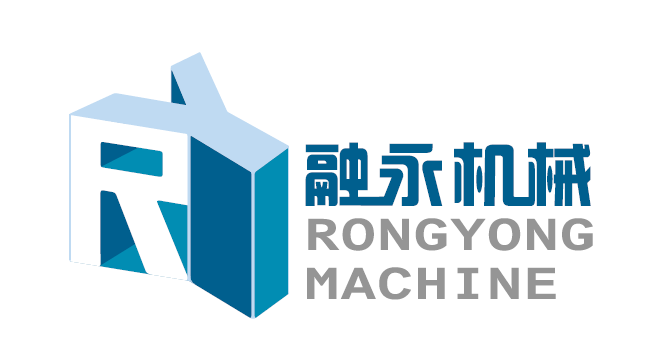

# 融永智档工具箱 RYMachineDocKit

融永机械出品的 Windows 桌面文档工具箱（Python + PySide6），把套料助手里广受好评的
PDF 提取 / PDF 编辑 / 文件归类三个 Web 功能沉淀为本地应用，并新增文件夹/文件批量重命名。



## 功能

| 模块 | 说明 |
| --- | --- |
| **PDF 提取** | 关键字定位取值（向右/向下），支持单文件或整目录批量，结果导出 Excel |
| **PDF 编辑** | 预览页面拖拽框选，遮罩原文 + 重写新文字（嵌入中文字体），一次框选可应用到任意页码范围 |
| **文件归类** | 按套料图命名规则（项目编号/仓号字母）两级归类；重名进 `_重名`、识别不了进 `_未识别`、非 PDF 进 `其他文件`；支持文件夹与 zip |
| **批量重命名** | 查找替换（支持正则）、前后缀、序号、大小写、按修改时间插日期；预览 + 冲突检测 + 一键撤销 |

## 运行

```bash
pip install -r requirements.txt
python main.py
```

要求：Windows 10/11，Python 3.10+。

## 打包

```bash
pip install pyinstaller
pyinstaller RYMachineDocKit.spec
```

产物：`dist/RYMachineDocKit/RYMachineDocKit.exe`（或用 `build.bat` 一键打包单文件版）。

## 目录结构

```
RYMachineDocKit/
├── main.py                  # 入口
├── app/
│   ├── ui/                  # 主题、主窗口、通用组件
│   ├── modules/
│   │   ├── pdf_extract/     # PDF 提取
│   │   ├── pdf_edit/        # PDF 编辑
│   │   ├── file_classify/   # 文件归类
│   │   └── batch_rename/    # 批量重命名
│   └── resources/           # logo 等资源
└── RYMachineDocKit.spec     # PyInstaller 打包配置
```

## 说明

- 所有处理都在本地完成，不上传任何数据。
- PDF 编辑的中文输出优先使用系统自带 `simhei.ttf` 等字体。
- 批量重命名的撤销记录保存在目标目录的 `.rename_undo.json`。
